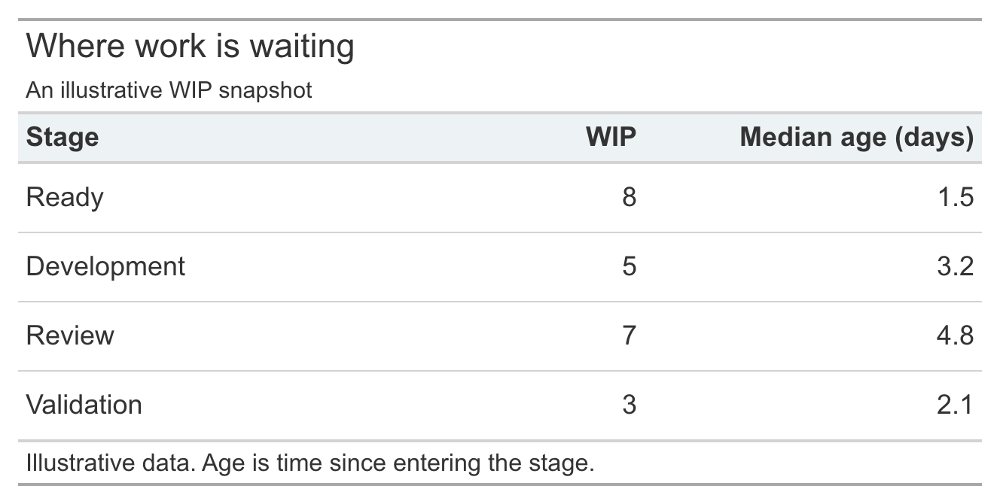

# Rethinking Flow

When I first started writing about measuring flow here on The Polaris Flow Dispatch, my thinking was aligned with the established concepts and principles
of Lean software development.

To measure flow of work in a development process, we started with some chosen unit of work called a work-item, and followed it through the process from start to finish. Throughput measured the number of finished work item over a reporting period, and cycle time measured the time it took to complete each work item. Work-in-process counts and work item age gave us related metrics for incomplete work.

One of the areas where I was looking to improve on the status quo at the time, was in figuring how to use flow metrics for more than business facing reports.
I belived the real power of flow metrics came from being able to reason rigorously about a development process as a whole. The individual metrics are useful not simply because of what each number says in isolation, but because of the established relationships between the metrics themselves, and how the changes in values impact each other. In theory, Little's Law supplied the relationship between the metrics but this power rarely seemed to be exploited by practitioners, not exposed in any of the commercial tools. This was a gap I set out to fill in the proprietary measurements tools I use in my advisory practice.

Just as important, Little's Law gives us measurable conditions that let us distinguish between stable and unstable flow. There were three reasons for focusing on measuring stability.

- An unstable process takes in more work than it can complete, and this is very common in software development. Stability then us an operational proxy to measure development capacity, a quantity that is notoriously hard to measure directly in software.

- In a stable process, the standard flow metrics settle down to stable values when measured over sufficiently long time windows. Little's Law tells us how their values must relate *to each other* when they stabilize. This allows us to reason about *the process as whole* over those horizons. In a stable process, the statistical differences between flow metrics for completed work and incomplete work becomes insignificant. This allows us to treat "work items" as a coherent population whose statistical properties accurately measure the properties of the process as a whole. Further, when flow metrics stabilize, it gives us a plausible basis to posit that the future behavior of the process, as measured by those statistics, will resemble past behavior. This is a pre-requisite for many forecasting techniques.

- If you try to improve an unstable process, your cant measure the improvement. It never clear whether the measured improvements are due to the changes you made, or due to transients that were already present *in the measurement*. Stabilizing the process gives us a baseline where this is no longer an issue. If you can show that you have moved the process from one stable regime to another, then it is rigorously defensible evidence of sustained improvement.

The goal then was to leverage flow metrics to make the improvement playbook measurable.

- Focus on the process where you are trying to improve the flow of work.
- Measure if it is stable and if not stabilize it by first.
- Once you have a stable process and flow metrics, show that any improvements you have made have shifted the process to a new stable regime.
- The flow metrics in the new stable regime unambiguously show what improved.

The power of this technique is that it does not depend on how you change the process. In practice, much of the conventional playbook for improving flow: limiting WIP, slicing work and working in small batches, automating key parts of the workflow etc, were still relevant. What was missing was a theoretically defensible way to establish stability and measure improvement using flow metrics. I expected that gap to be straightforward to fill; after all, we already had the metrics and Little’s Law to connect them.  But things turned out to be much more complicated.

if you measured flow metrics using the prevalent definitions that all commercial tools at the time had adopted, I found it was impossible to reliably detect stable regimes or regime shifts using Little's Law as the diagnostic check. At the very least, this indicated a disconnect between theory and practice.

Unraveling that thread to understand what was happening here has taken me the better part of three years. It required returning to the original mathematical proofs of Little’s Law to understand how it works and why it holds, from first principles. The results, which I wrote about extensively in last years edition, [Little's Law page](https://docs.pcalc.org/articles/littles-law/), made me realize that we needed to rethink many fundamental aspects of how we model and measure flow in software development.

It led me to the technique of sample path analysis, a technique that was first used by Dr. Shaler Stidham to give the first known deterministic proof of Little's Law. The technique is powerful because it operates on a very primitive representation of a process: its realized history represented as an ordered sequence of timestamps representing starts and finishes of work items over a finite observation window. This is called a sample path for the process.

Given a sample path, he showed how to define flow metrics such that they are deterministic functions of the path. Unlike the steady state flow metrics we see in Little's Law they are not statistical averages of work item level metrics. They are properties of the observed sample path as a whole, and they can be defined over every finite prefix of the observed history, whether or not the process is stable. Further, these quantities have the property that they satisfies a Little's Law type conservation law at all times. This makes them ideal primitives for measuring flow when the process is unstable. What closes the loop is the result that when the process is stable, these quantities become equivalent to the steady state quantities in Little's Law.

What this meant was the the overall approach to using Little's Law and flow metrics as tools for detecting shifts in operating regimes was sound.
But that the conventional ways of measuring flow metrics had to change in order to do this. All this was described in last year's posts, and I demonstrated how to do this in principle using several example scenarios and data sets.

But it had not yet gelled
into a coherent measurement system. In particular, I had not fully
separated three questions that are routinely mixed together:

1. What can we measure exactly from the history that has already occurred?
2. What can we infer statistically from that history and when?
3. What can we predict about histories that have not yet occurred?

# A Waypost: Turning the Ideas Into Software

Since publishing that series, I have been working on an open-source [sample-path analysis toolkit](https://github.com/presence-calculus/samplepath). The toolkit reconstructs an event-resolved flow process from operational data, computes finite-window flow measurements, and produces charts and diagnostics for studying process dynamics, convergence, coherence, and stability.

Its [chart reference](https://samplepath.pcalc.org/articles/chart-reference) shows the measurements the toolkit currently implements and how each one is derived from the event history.

The software is not the subject of this series. It is a waypost. Turning the definitions into executable calculations resolved ambiguities and showed that the differences from conventional flow metrics are not merely terminological.

Sample path analysis, it turns out, is a fundamentally different approach to operational measurements that is particularly well suited for reasoning about software development processes. It is not merely an complementary set of measurement techniques, but a much more powerful alternative with applications far beyond the initial problem I was looking to solve when I started out.

# The Road Ahead

In this series we will describe the technique of sample path analysis starting from the very basics so that we can make this argument and show its generality and power in full detail.

First, we will revisit the claim that flow mathematics is not manufacturing specific. The mathematics may be substrate-independent, but a model still depends on choices about events, state, boundaries, and purpose. A useful representation of an assembly line is not automatically the right one for knowledge work.

Second, we will ask what happened before the histogram. Flow processes unfold as ordered histories. Aggregation and empirical distributions can be useful, but they discard event order and elapsed-time structure.

Third, we will return to Little's Law before equilibrium. Starting from events, we can derive process state, accumulated presence, time-average presence, and a finite-window invariant that holds along every observed path. This gives us a way to reason about flow while it is changing, rather than only after its averages have settled down.

Fourth, we will reconsider the idea that stability must come first. Convergence, coherence, and the timescales over which process properties become meaningful can themselves be observed. Transience and instability are process behavior, not reasons to abandon analysis.

Fifth, we will ask whether a decision actually requires a forecast. The usual "flaw of averages" argument replaces point estimates with distributions and Monte Carlo simulation, but that response presupposes a defensible probability model. We will examine what can instead be learned from constraints, current state, accumulated exposure, feedback, optionality, and adaptability.

Finally, we will make our first sustained foray into forecasting in *The Polaris Flow Dispatch*. I have long been skeptical that resampling historical throughput is sufficient to produce meaningful probabilities about the future of a software-development process. I now have a more precise account of that skepticism. We will ask what evidence a probabilistic flow forecast must earn, not promise a new forecasting recipe.

# Beyond the Flow of Work

The immediate purpose of this series is to develop a more rigorous way to measure and reason about operational flow. But that is not the final destination.

Work in progress, delay, cycle time, and throughput are not value. Improving them may change economic outcomes, but none is a literal proxy for those outcomes. Ultimately, I want to connect operational processes to the tangible and intangible exchanges through which participants create value together.

Value networks offer a promising representation of those interactions. A history of reciprocal value exchanges can be represented as a marked event process, opening the possibility of applying the more general forms of Little's Law to value accumulation as well as time accumulation. Considerable conceptual and computational machinery still has to be built before that claim becomes operationally useful.

This series is the next step in building it.
